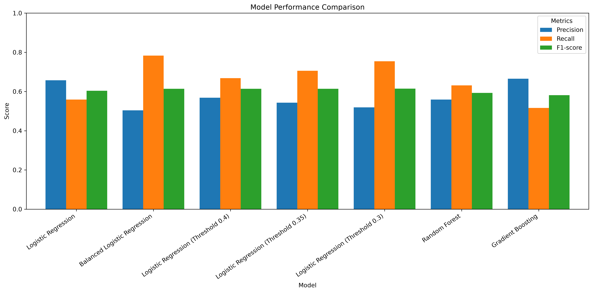
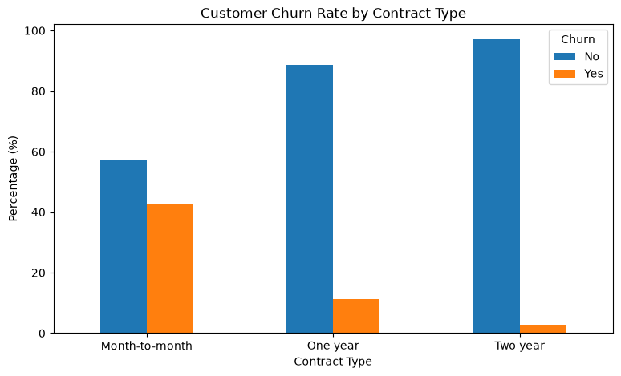
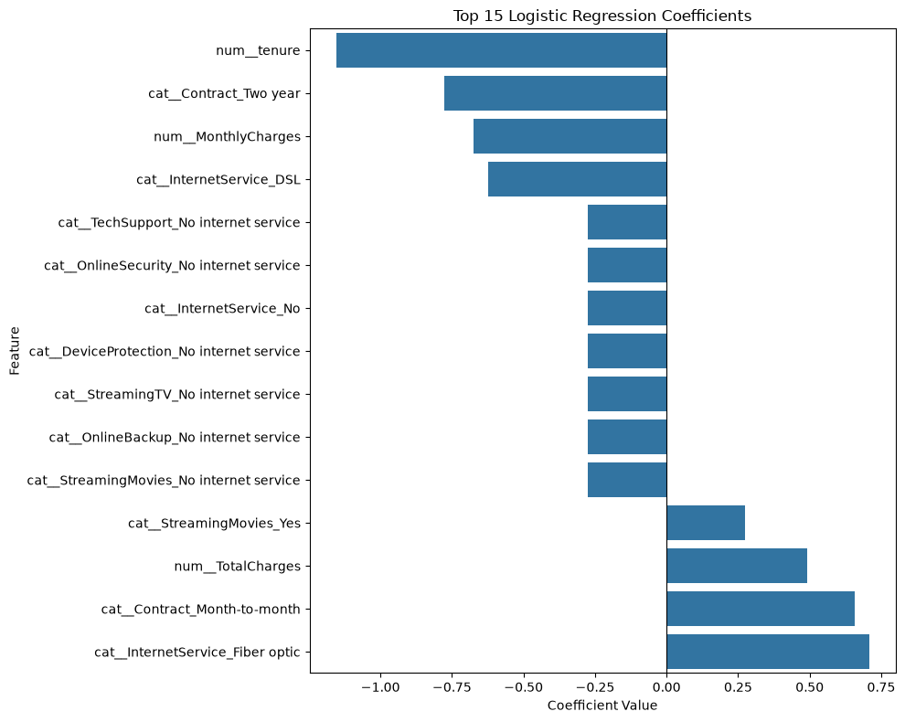
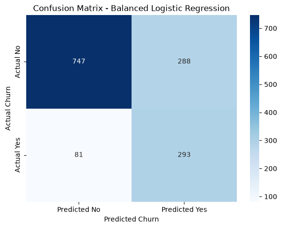
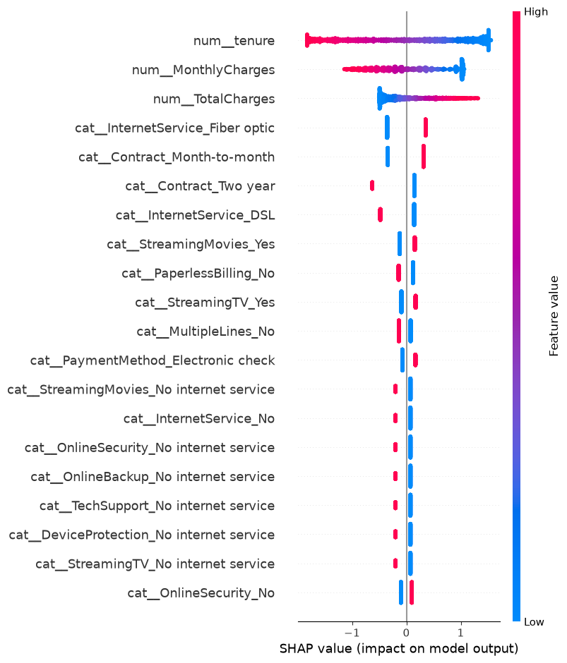
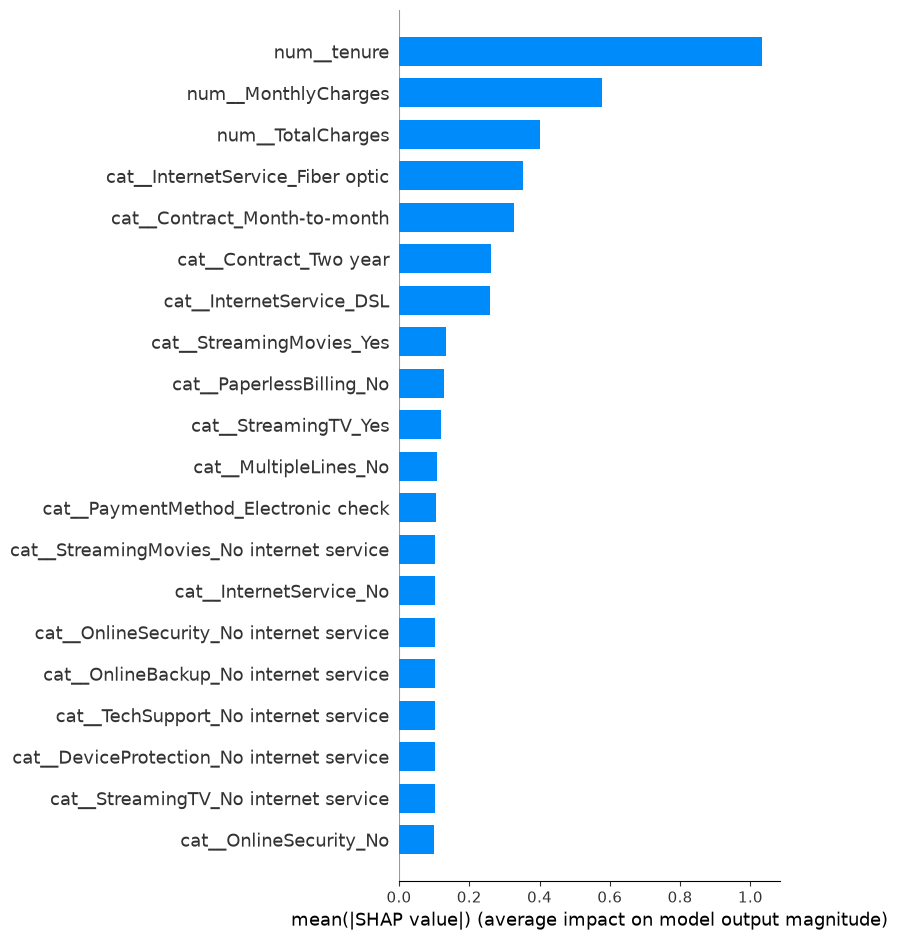

# Customer Churn Analysis and Prediction

## Project Overview

Customer churn is a major challenge for telecommunications companies because losing existing customers can negatively affect revenue and long-term business growth.

This project analyses customer data from a telecommunications company to identify patterns associated with customer churn and develop machine learning models that predict customers who are likely to discontinue their services.

The project combines data cleaning, exploratory data analysis, statistical hypothesis testing, SQL-based data analysis, and machine learning to generate insights into customer behaviour. It also explores model interpretability techniques to understand the factors influencing churn predictions.

The ultimate goal is to provide actionable insights that can help the business identify at-risk customers and make more informed customer retention decisions.

## Business Problem

Telecommunications companies operate in a competitive environment where customer retention is essential for maintaining revenue and profitability.

Customer churn occurs when customers discontinue their subscriptions or services. However, identifying customers who are likely to leave can be challenging, particularly when dealing with large volumes of customer data.

Without a clear understanding of customer behaviour, businesses may struggle to identify at-risk customers and implement effective retention strategies.

This project addresses the following business question:

**Can customer data be used to identify the factors associated with churn and predict customers who are likely to leave a telecommunications company?**

## Project Objectives

The main objectives of this project are to:

- Clean and prepare telecommunications customer data for analysis.
- Perform exploratory data analysis to identify patterns and trends associated with customer churn.
- Apply statistical hypothesis testing to investigate relationships between customer attributes and churn.
- Use SQL to query and analyse customer data.
- Develop and evaluate machine learning models for predicting customer churn.
- Compare model performance using appropriate classification metrics.
- Apply model interpretability techniques to understand the factors influencing churn predictions.
- Translate analytical findings into actionable business recommendations.

## Dataset Description

The project uses a telecommunications customer dataset containing **7,043 customer records and 21 columns**.

Each record represents an individual customer and contains information about their demographics, account details, subscribed services, billing information and churn status.

The dataset includes the following categories of information:

- **Customer demographics:** Gender, senior citizen status, and whether the customer has a partner or dependants.
- **Account information:** Tenure, contract type, payment method and paperless billing.
- **Subscribed services:** Internet service, phone service, online security, device protection, streaming services and other subscribed features.
- **Billing information:** Monthly charges and total charges.
- **Target variable:** `Churn`, indicating whether a customer discontinued their services.

The `customerID` column serves as a unique customer identifier and is excluded from predictive modelling.

The target variable, `Churn`, is used to distinguish between customers who stayed and those who discontinued their services.

## Project Workflow

The project follows a structured data analysis and machine learning workflow.

### 1. Data Cleaning and Preparation
- Loaded the telecommunications dataset.
- Inspected the dataset for missing values, duplicates and inconsistent data types.
- Cleaned whitespace-only values in the `TotalCharges` column.
- Converted relevant columns to appropriate data types.

### 2. Exploratory Data Analysis (EDA)
- Examined the distribution of customer churn.
- Analysed relationships between customer demographics, subscribed services, account information and churn.
- Used descriptive statistics and visualisations to identify patterns associated with customer churn.

### 3. Statistical Analysis
- Applied Chi-square tests to investigate associations between categorical variables and customer churn.
- Used Mann–Whitney U tests to compare numerical variables between customers who churned and those who stayed.
- Applied Cramér's V to assess the strength of associations between categorical variables.

### 4. Data Preprocessing
- Separated the dataset into training and testing sets using stratified sampling.
- Standardised numerical features using `StandardScaler`.
- Encoded categorical features using `OneHotEncoder`.
- Prepared the processed data for machine learning.

### 5. Machine Learning
- Developed Logistic Regression and Balanced Logistic Regression models.
- Investigated classification threshold optimisation.
- Applied AIC-based feature selection.
- Developed Random Forest and Gradient Boosting models.
- Compared model performance using classification metrics.

### 6. Model Evaluation and Interpretability
- Evaluated models using accuracy, precision, recall, F1-score and ROC-AUC.
- Selected Balanced Logistic Regression based on its ability to identify customers likely to churn.
- Used Logistic Regression coefficients and SHAP to interpret model predictions and identify influential customer attributes.

### 7. Business Recommendations
- Translated analytical findings into customer retention recommendations.
- Considered the trade-off between identifying potential churners and the cost of retention interventions.


## Technologies and Tools

The project uses the following technologies and tools:

| Technology | Purpose |
|---|---|
| Python | Data analysis and machine learning |
| Pandas | Data manipulation and analysis |
| NumPy | Numerical computations |
| Matplotlib | Data visualisation |
| Seaborn | Statistical data visualisation |
| SciPy | Statistical hypothesis testing |
| Scikit-learn | Data preprocessing, model training and evaluation |
| SHAP | Model interpretability |
| Statsmodels | Statistical modelling and AIC-based feature selection |
| SQL | Database querying and data analysis |
| SQLite | Relational database management |
| Jupyter Notebook | Interactive analysis and documentation |
| Git and GitHub | Version control and project management |
| VS Code | Development environment |

## Project Structure
customer-churn-analysis/
├── data/
│   ├── raw/
│   │   └── customer_raw_data.csv
│   └── processed/
│       └── customer_cleaned_data.csv
├── database/
│   └── customer_churn.db
├── figures/
│   ├── balanced_logistic_confusion_matrix.png
│   ├── churn_rate_by_contract.png
│   ├── logistic_regression_coefficients.png
│   ├── model_performance_comparison.png
│   ├── shap_feature_importance.png
│   └── shap_summary_plot.png
├── notebooks/
│   └── customer_churn_analysis.ipynb
├── reports/
│   └── data_dictionary.md
├── sql/
│   ├── create_tables.sql
│   └── analysis_queries.sql
├── src/
│   ├── data_cleaning.py
│   ├── database.py
│   ├── exploratory_analysis.py
│   ├── model_evaluation.py
│   ├── model_training.py
│   └── preprocessing.py
├── requirements.txt
└── README.md

## Model Performance and Results

Several machine learning models were developed and evaluated to identify customers likely to churn.

The models were evaluated using accuracy, precision, recall, F1-score and ROC-AUC, with particular emphasis on recall because identifying as many potential churners as possible was a key project objective.

### Model Comparison

| Model | Accuracy | Precision | Recall | F1-score | ROC-AUC |
|---|---:|---:|---:|---:|---:|
| Logistic Regression | 80.55% | 65.72% | 55.88% | 60.40% | 0.8421 |
| Balanced Logistic Regression | 73.81% | 50.43% | 78.34% | 61.36% | 0.8416 |
| Random Forest | 77.00% | 55.92% | 63.10% | 59.30% | 0.8213 |
| Gradient Boosting | 80.27% | 66.55% | 51.60% | 58.13% | 0.8434 |

### Selected Model: Balanced Logistic Regression

Balanced Logistic Regression was selected as the final model because it achieved the highest recall of **78.34%** among the evaluated models.

This means that the model correctly identified approximately 78 out of every 100 customers who actually churned in the test dataset.

The model achieved:

- **Accuracy:** 73.81%
- **Precision:** 50.43%
- **Recall:** 78.34%
- **F1-score:** 61.36%
- **ROC-AUC:** 0.8416

The use of class weighting helped address the imbalance between customers who churned and those who stayed, improving the model's ability to identify potential churners.

However, the improvement in recall came with a reduction in precision, resulting in more false-positive predictions. This trade-off is important when considering the cost and allocation of customer retention resources.


## Key Findings

The exploratory, statistical and predictive analyses revealed several important patterns associated with customer churn:

- **Contract Type:** Customers on month-to-month contracts had a substantially higher churn rate (42.71%) compared with customers on one-year (11.27%) and two-year contracts (2.83%).
- **Customer Tenure:** Customers who churned generally had shorter tenure than customers who remained with the company.
- **Monthly Charges:** Customers who churned tended to have higher monthly charges.
- **Internet Service:** Internet service type was associated with customer churn, with fiber optic customers showing higher churn levels.
- **Customer Churn Distribution:** Approximately 26.54% of customers in the dataset had churned, indicating a class imbalance in the target variable.

The model interpretability analysis also identified customer tenure, monthly charges, total charges, contract type and internet service as influential features in the Balanced Logistic Regression model's predictions.

## Business Recommendations

Based on the findings, the following recommendations could help improve customer retention:

1. **Prioritise Month-to-Month Customers:** Develop targeted retention strategies for customers on month-to-month contracts, as this group has a considerably higher churn rate.

2. **Focus on New Customers:** Introduce early engagement and onboarding initiatives to support customers during the initial stages of their relationship with the company.

3. **Review Pricing Strategies:** Investigate whether higher monthly charges are contributing to customer dissatisfaction and consider more competitive pricing or tailored service packages.

4. **Target High-Risk Customers:** Use the selected Balanced Logistic Regression model to identify customers with a higher predicted likelihood of churn.

5. **Allocate Retention Resources Strategically:** Since the selected model produces false-positive predictions, begin with relatively low-cost retention interventions and reserve more expensive incentives for customers assessed as being at particularly high risk.

6. **Monitor Retention Campaigns:** Track the effectiveness of retention initiatives over time and evaluate whether they reduce actual customer churn.

These recommendations provide a starting point for data-driven customer retention strategies. Further evaluation using real campaign outcomes would be necessary to establish their effectiveness.


## Installation and Setup

Follow these steps to set up the project locally.

### 1. Clone the repository

```bash
git clone https://github.com/IsiphileIsie/Customer-churn-analysis.git
cd Customer-churn-analysis
```

### 2. Create a virtual environment

```bash
python3 -m venv venv
```

### 3. Activate the virtual environment

For Linux and macOS:

```bash
source venv/bin/activate
```

Windows (Command Prompt):

venv\Scripts\activate.bat

Windows (PowerShell):

.\venv\Scripts\Activate.ps1

### 4. Install the required dependencies

```bash
pip install -r requirements.txt
```

### 5. Launch the Jupyter Notebook

```bash
jupyter notebook notebooks/customer_churn_analysis.ipynb
```

The notebook contains the complete analysis, from data cleaning and exploratory analysis through statistical testing, model development, evaluation, and interpretability.


## Visualisations and Results

### 1. Model Performance Comparison

Compares Precision, Recall and F1-score across the seven machine learning models evaluated.



### 2. Churn Rate by Contract Type

Illustrates the differences in customer churn rates across month-to-month, one-year and two-year contracts.



### 3. Logistic Regression Coefficients

Shows the direction and magnitude of the selected Logistic Regression model's feature coefficients.



### 4. Confusion Matrix

Shows the classification results of the selected Balanced Logistic Regression model.



### 5. SHAP Summary Plot

Illustrates how different features influence the model's churn predictions and the direction of their contributions.



### 6. SHAP Feature Importance

Ranks features according to their mean absolute SHAP values, highlighting the features with the greatest overall influence on model predictions.




## SQL and Database Analysis

The project uses SQLite to store and analyse customer information. The database contains a `customers` table with 21 columns covering customer demographics, subscribed services, account information, billing details and churn status.

### Database Structure

- **Database:** `database/customer_churn.db`
- **Table:** `customers`
- **Schema:** `sql/create_tables.sql`

The database schema defines `customerID` as the primary key and stores customer information using appropriate SQLite data types.

### SQL Analysis

The project includes 10 SQL queries designed to answer business-related questions, including:

- Total number of customers and customers who churned.
- Contract types with the highest number of churned customers.
- Payment methods associated with customer churn.
- Churn among senior and non-senior citizens.
- Internet services with the highest number of churned customers.
- Average monthly charges among churned customers.
- Churn rates by gender.
- Monthly charges aggregated by payment method.

The queries are available in `sql/analysis_queries.sql`.


### Accessing the SQLite Database

The SQLite database is included in the repository at `database/customer_churn.db`.

To inspect the available tables:

```bash
sqlite3 database/customer_churn.db ".tables"
```

To count the customer records:

```bash
sqlite3 database/customer_churn.db "SELECT COUNT(*) FROM customers;"
```

To inspect the table structure:

```bash
sqlite3 database/customer_churn.db "PRAGMA table_info(customers);"
```

The database contains 7,043 customer records stored in the `customers` table.

The SQL schema and analysis queries are provided in the `sql/` directory.


### Accessing the Database Through Python

The project includes a reusable database module located at `src/database.py`. It provides functions for connecting to the SQLite database and retrieving customer records.

**Available functions:**

| Function | Description |
|---|---|
| `connect_to_database()` | Establishes a connection to the SQLite database. |
| `load_customer_data()` | Loads all customer records into a Pandas DataFrame. |
| `read_query(query)` | Executes a SQL query and returns the results as a Pandas DataFrame. |

**Example: Loading customer data**

```python
from src.database import load_customer_data

customers = load_customer_data()

print(customers.head())
```

**Example: Executing a SQL query**

```python
from src.database import read_query

query = """
SELECT Contract, COUNT(*) AS customer_count
FROM customers
GROUP BY Contract;
"""

results = read_query(query)
print(results)
```

The database connection is automatically closed after each data retrieval operation.


## Project Limitations

- **Dataset scope:** The analysis uses a single telecom customer dataset containing 7,043 records. The findings may not generalise to other telecom providers or customer populations.
- **Class imbalance:** Customers who stayed represent approximately 73.46% of the dataset, while customers who churned represent 26.54%. This imbalance affects model performance and the interpretation of evaluation metrics.
- **Model trade-offs:** The selected Balanced Logistic Regression model achieves a churn recall of 78.34%, but its precision is 50.43%. This means some customers identified as likely to churn may not actually leave.
- **Association versus causation:** The statistical findings and model interpretations identify relationships between customer characteristics and churn. They do not establish that these characteristics directly cause customers to leave.
- **Model evaluation:** Performance was evaluated using a stratified train-test split. Further validation on new customer data would help assess how well the model generalises to unseen populations.
- **Operational deployment:** The model has not yet been integrated into a live customer retention system. Its predictions would need to be monitored and evaluated before being used for operational decisions.
